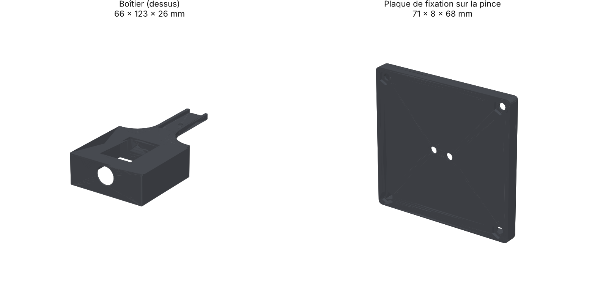
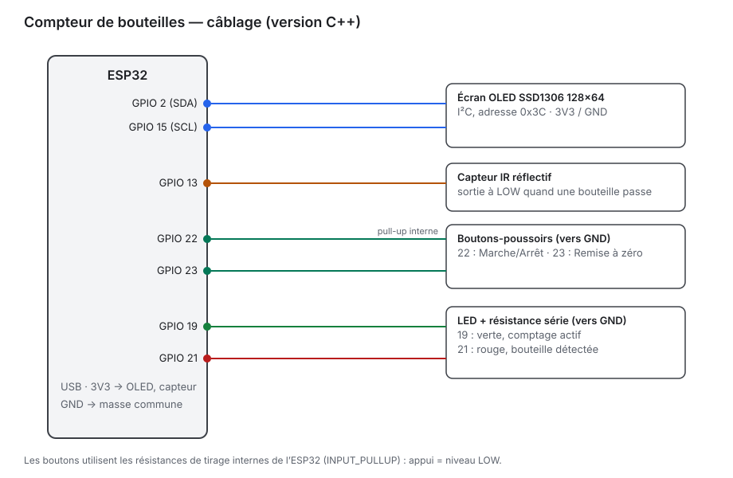

# Compteur de bouteilles

Compteur de bouteilles autonome pour une ligne d'embouteillage artisanale, réalisé pour le domaine viticole de mon frère (Abbet-vins). Un capteur infrarouge réflectif détecte chaque bouteille qui passe devant le boîtier, un ESP32 compte les passages et affiche le total en grand sur un écran OLED.

Le boîtier imprimé en 3D se fixe sur une pince universelle du commerce, ce qui permet de l'installer sur n'importe quel bord de table ou de convoyeur sans modifier la ligne.

## Contenu du dépôt

| Dossier | Contenu |
|---|---|
| `arduino/compteur_bouteille/` | Version finale en C++ (Arduino, ESP32), celle qui tourne dans le boîtier |
| `micropython/` | Premières versions en MicroPython (v1 à v4) et le pilote `ssd1306.py` |
| `cao/` | Pièces du boîtier : fichiers Inventor (`.ipt`, `.iam`) et exports `.stl` |
| `docs/` | Schéma de câblage et rendu du boîtier |

## Matériel

- ESP32 (carte de développement, alimentation USB)
- Capteur infrarouge réflectif à sortie numérique (sortie à l'état bas quand un objet est présent)
- Écran OLED SSD1306 128 × 64, I²C, adresse 0x3C
- 2 boutons-poussoirs (Marche/Arrêt, Remise à zéro)
- 2 LED (verte : comptage actif, rouge : bouteille détectée) avec résistance série
- Boîtier imprimé en 3D + pince universelle du commerce

## Câblage (version C++)

| Élément | Broche ESP32 |
|---|---|
| OLED SDA | GPIO 2 |
| OLED SCL | GPIO 15 |
| Capteur IR (sortie) | GPIO 13 |
| Bouton Marche/Arrêt | GPIO 22 (vers GND, pull-up interne) |
| Bouton Remise à zéro | GPIO 23 (vers GND, pull-up interne) |
| LED verte | GPIO 19 |
| LED rouge | GPIO 21 |

Les versions MicroPython utilisent un autre brochage (capteur 18, boutons 19 et 23, LED 25 et 26, OLED SDA 21 / SCL 22) : il est indiqué en tête de chaque fichier.

## Fonctionnement

1. Au démarrage, l'écran affiche « Abbet-vins » pendant 2 s, puis le total enregistré.
2. Le bouton **Marche/Arrêt** lance ou suspend le comptage (LED verte allumée = comptage actif).
3. À chaque **front descendant** du capteur (passage de HIGH à LOW, c'est-à-dire l'arrivée d'une bouteille), le compteur augmente de 1 et la LED rouge s'allume tant que la bouteille est devant le capteur.
4. Le bouton **Remise à zéro** remet le total à 0.
5. Le total est enregistré dans la mémoire flash de l'ESP32 (bibliothèque `Preferences`) toutes les 10 bouteilles, à l'arrêt et à la remise à zéro. Après une coupure de courant, le compteur repart du dernier total enregistré : au pire, les 9 dernières bouteilles sont à recompter (écrire à chaque bouteille userait inutilement la mémoire flash).

### Anti-rebond et cadence maximale

Après un comptage, tout nouveau front est ignoré pendant 150 ms. Cela évite de compter deux fois une bouteille dont le bord ou l'étiquette fait varier le signal du capteur.

Ce délai fixe la cadence maximale mesurable :

- intervalle minimal entre deux bouteilles : 150 ms = 0,150 s
- cadence maximale = 1 / 0,150 s ≈ 6,67 bouteilles/s
- par minute : 6,67 × 60 ≈ 400 bouteilles/min

Une petite ligne d'embouteillage artisanale reste largement en dessous de cette valeur.

## Compiler et téléverser (version C++)

1. Installer l'[IDE Arduino](https://www.arduino.cc/en/software) et le support des cartes ESP32 (gestionnaire de cartes : « esp32 » par Espressif).
2. Installer les bibliothèques **Adafruit SSD1306** et **Adafruit GFX** (gestionnaire de bibliothèques).
3. Ouvrir `arduino/compteur_bouteille/compteur_bouteille.ino`, choisir la carte ESP32 et le port, puis téléverser.
4. Le moniteur série (115 200 bauds) affiche les messages de démarrage, et le total si l'écran n'est pas détecté.

## Version MicroPython

Les fichiers `micropython/bottlecounter1.py` à `bottlecounter4.py` retracent l'évolution du projet : la v1 contient déjà la machine à états (détection minimale de 20 ms, temps mort de 200 ms) et la sauvegarde du total, la v2 ajoute l'écran OLED, la v3 les LED, la v4 l'écran d'accueil et l'affichage en grands chiffres. Pour les essayer : flasher MicroPython sur l'ESP32, copier `ssd1306.py` et le fichier voulu (renommé en `main.py`) avec Thonny ou `mpremote`.

## Boîtier

| Pièce | Dimensions |
|---|---|
| `top` : boîtier qui reçoit l'électronique, l'écran et le capteur | 66 × 123 × 26 mm |
| `socle` : plaque qui se visse sur la pince universelle | 71 × 8 × 68 mm |

Les fichiers source sont au format Autodesk Inventor ; les `.stl` sont prêts à imprimer.

## Licence

Code et fichiers de conception sous licence MIT (voir [LICENSE](LICENSE)).

Mattéo Pozzo di Borgo
